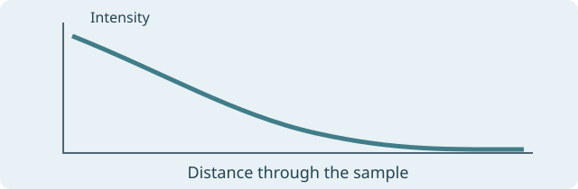

# Light absorption study

## Results in context

Compare @fig:sample with @fig:curve. Use @eq:decay to check the model. The labels stay in the source for export.

{#fig:sample}

{#fig:curve}

## Model

$$
I(x) = I_0 e^{-\alpha x}
$$
{#eq:decay}

The measured curve in @fig:curve follows @eq:decay. Select a reference number to open its source line.
